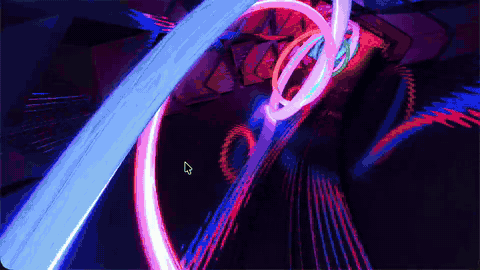
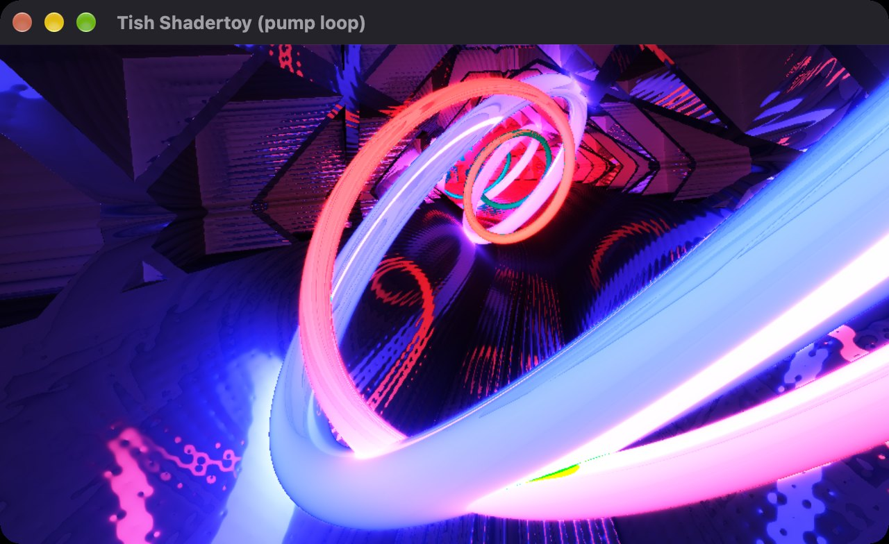
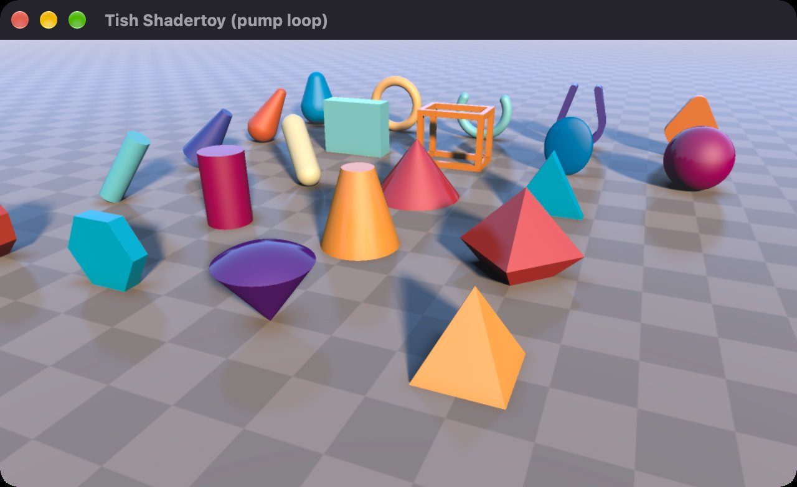
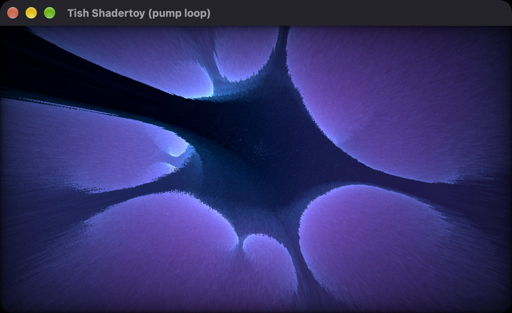
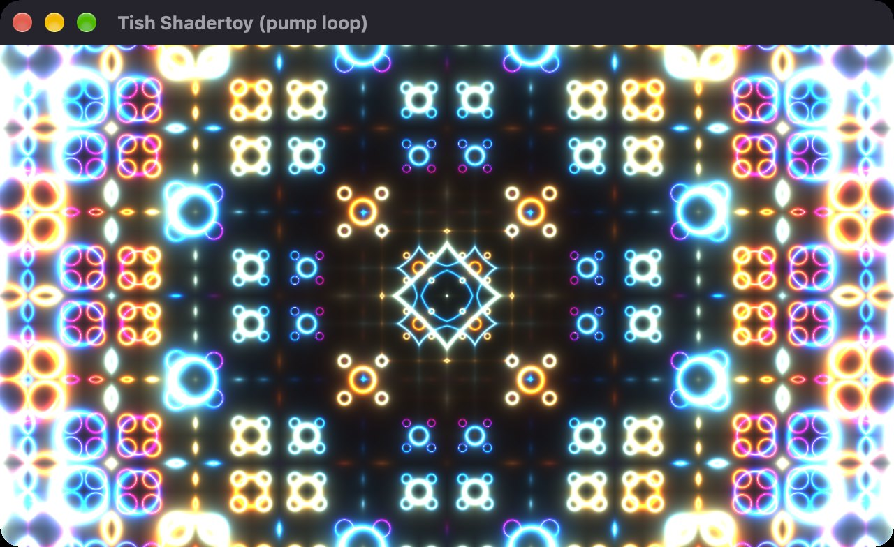
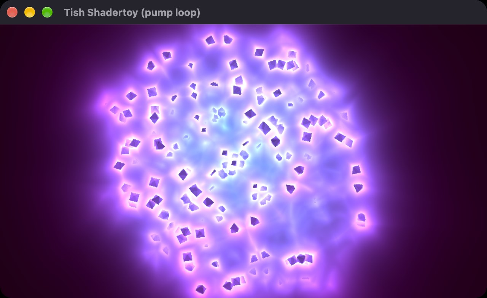
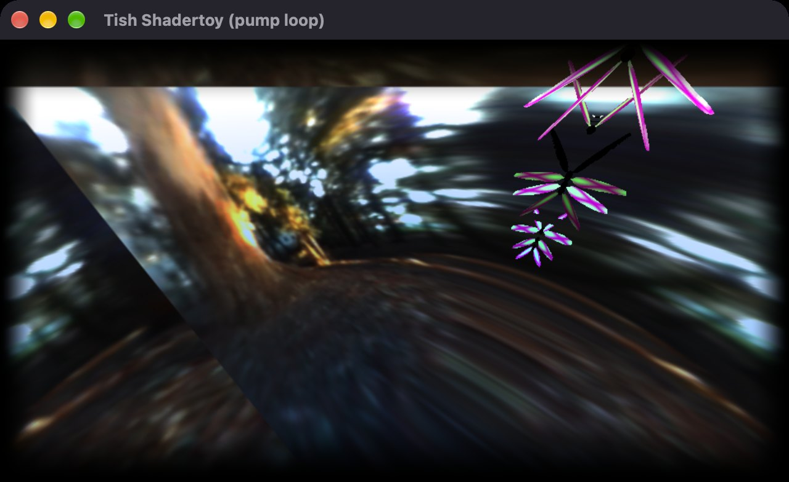

# tish-shadertoy

Run [Shadertoy](https://www.shadertoy.com/) shaders in a native OpenGL window, driven from
[Tish](https://tishlang.com/). Point it at a GLSL file written for Shadertoy — the usual `mainImage` image
pass — and it runs full screen in a native window. No browser, no editor.



<sub>[Full-quality video](docs/media/reel.mp4) · every frame above is the native viewer running a shader from [`shaders/`](shaders/).</sub>

| | | |
|---|---|---|
|  |  |  |
|  |  |  |

## Why

Shadertoy shaders are written for WebGL in a browser tab. tish-shadertoy runs the same code on desktop
OpenGL from a Tish script, so a shader can be a native visual — a background, a visualiser, a demo — with
Tish in control of the loop. It is built for real community shaders, unmodified:

- **The full Shadertoy uniform set** — `iResolution`, `iTime`, `iTimeDelta`, `iFrame`, `iFrameRate`, `iMouse`
  (with Shadertoy's click-and-drag rules), `iDate`, `iSampleRate`, `iChannelResolution`, `iChannelTime`, and
  `iGlobalTime`.
- **WebGL-to-desktop compatibility fixes** — the gaps that usually turn a working Shadertoy shader black on
  desktop GL are patched before compiling (see [Compatibility](#compatibility)).
- **Texture channels** — `iChannel0`–`3` from image files, set per shader with a comment or from the
  environment, plus a built-in procedural noise texture.
- **Tuned for heavy raymarchers** — fixed physical resolution on HiDPI screens, an internal render scale, no
  multisampling by default, and optional uncapped frame rate.

## Quick start

You need Node (for the `tish` CLI), Rust (`cargo`, which `tish build` uses to compile), and a GPU with
OpenGL 3.3 or a compatible GLES fallback.

```bash
git clone https://github.com/spacedevin/tish-shadertoy
cd tish-shadertoy
npm install
npm start
```

`npm start` builds the pumped example with `tish build` (a couple of minutes the first time; it reuses the
binary after that) and runs it on [`shaders/`](shaders/), switching to the next shader every 8 seconds. Close the window or press **Escape** to quit.

`tish:shadertoy` is a native module, so it runs from a compiled Tish program: `tish build` turns the `.tish`
source into a native binary with the module linked in. (`tish run`, the interpreter, can't load third-party
native modules.)

## Examples

Two small programs, one for each way of using the module. Build either with `tish build` and point it at a
shader:

```bash
npm run build                                        # both, into target/
target/blocking shaders/XstXR2.glsl
target/pumped shaders/7cjGRR.glsl                    # one shader
target/pumped shaders/                               # every shader in a folder, 8 seconds each
```

**[`examples/blocking`](examples/blocking/main.tish)** — the simplest use: open a shader and block until the
window closes.

```js
import { readFile } from 'tish:fs'
import { run } from 'tish:shadertoy'

run(readFile('shaders/XstXR2.glsl'))
```

**[`examples/pumped`](examples/pumped/main.tish)** — Tish keeps control of the loop. `openPumpable` opens the
window without blocking and each `pump()` draws one frame and returns, so the program can do its own work in
between. The example uses that to cycle through a folder of shaders with `reloadShader` and keep the title
current:

```js
import { readFile } from 'tish:fs'
import { openPumpable, pump, setWindowTitle, reloadShader } from 'tish:shadertoy'

openPumpable(readFile('shaders/mtyGWy.glsl'))
let frame = 0
while (pump()) {
  frame = frame + 1
  if (frame === 1) {
    setWindowTitle('My visualiser') // the window exists once the first pump() has run
  }
  // timers, a queue, file watching… and reloadShader(newSource) whenever you like
}
```

| Function | |
|---|---|
| `run(code)` | Open the viewer and block until the window closes. |
| `openPumpable(code)` | Open the viewer without blocking; returns `false` if it is already open or GL fails to start. |
| `pump()` | Draw a frame and handle window events; returns `false` once the window is closed. Waits about 1 ms inside winit by default so the loop isn't CPU-bound (`TISH_SHADER_PUMP_TIMEOUT_MS` changes it). |
| `setWindowTitle(title)` | Set the window title. Takes effect once the window exists, after the first `pump()`. |
| `reloadShader(code)` | Swap in new shader source without reopening the window. |

`readFile` returns an `{ error }` object rather than a string when a file can't be read; both examples check
for that and exit with a clear message.

## Using it in your own project

Add `tish-shadertoy` as a dependency next to the Tish CLI, then build your program with `tish build`:

```bash
npm install --save-dev @tishlang/tish
npm install github:spacedevin/tish-shadertoy
npx tish build main.tish -o my-visualiser
./my-visualiser
```

`tish build` finds the native module through `node_modules/tish-shadertoy` (its `package.json` declares the
crate and the `shadertoy_object` export) and compiles it into your binary.

## Hotkeys

Bindings are Milkdrop-style and live in [`hotkeys.toml`](hotkeys.toml) in the working directory (or wherever
`TISH_SHADER_HOTKEYS_PATH` points). Defaults:

| Key | |
|---|---|
| `F3` | Toggle a smoothed FPS readout in the window title |
| `Escape` | Quit |

## Performance

The window has a **fixed physical size** (1280×720 by default), not a logical one, so HiDPI displays don't
silently render at 2× or 3× the pixels — which is what makes heavy raymarchers feel stuck under 20 FPS.

| Variable | |
|---|---|
| `TISH_SHADER_WIDTH`, `TISH_SHADER_HEIGHT` | Backing resolution in physical pixels. |
| `TISH_SHADER_RENDER_SCALE` | Internal render scale in (0, 1], default 1, clamped to 0.05–1.0. The `mainImage` pass runs at `window × scale` and is upscaled linearly; `0.5` is about 4× fewer fragment invocations. `iResolution` and `fragCoord` still match the full window, so Shadertoy math stays consistent. |
| `TISH_SHADER_VSYNC=0` | Disable vsync to see uncapped frame rates while tuning (may tear). |

The GL config prefers **no multisampling**: on a single full-screen triangle MSAA multiplies fragment cost
for little gain. Some shaders supersample on purpose (Inigo Quilez's distance-function demos with `AA 2` shade
2×2 per pixel, about 4× the work) — lower `AA` in the file if you need the speed.

```bash
TISH_SHADER_RENDER_SCALE=.5 TISH_SHADER_WIDTH=1024 TISH_SHADER_HEIGHT=1024 target/pumped shaders/7cjGRR.glsl
```

## Compatibility

Shadertoy runs WebGL (GLSL ES). Its docs tell authors to
[initialize their variables](https://github.com/NatronGitHub/openfx-misc/blob/master/Shadertoy/Shadertoy.md),
but plenty of community shaders rely on undefined reads behaving like zero in a browser — desktop OpenGL 3.3
often doesn't, and Apple's GL-on-Metal can turn the undefined value into NaN and a black screen. Before
compiling, the viewer patches the common cases:

| | Default | |
|---|---|---|
| `HW_PERFORMANCE` | on | Defined as `1` when the shader doesn't, as the site does; without it `#if HW_PERFORMANCE==0` fails on desktop GL. |
| `TISH_SHADER_COMPAT_ZEROINIT` | on | Adds `= 0` / `= vec4(0.0)` to common uninitialized declarations (`vec4 lights;`, `float i,s,d;`). |
| `TISH_SHADER_COMPAT_MAINIMAGE_INOUT` | on | Makes `mainImage`'s output `inout`, so shaders that read `fragColor` before writing it see zero rather than NaN on Apple/Metal. |
| `TISH_SHADER_COMPAT_MAT2_COS` | on | Expands `mat2(cos(vec4))` into explicit components; it can produce NaN on Apple GL 4.1. |
| `TISH_SHADER_COMPAT_SMOOTHSTEP` | on | Injects a safe `smoothstep`. |
| `TISH_SHADER_COMPAT_FLOAT_INC` | on | Rewrites `floatVar++` / `++floatVar` to `+= 1.0`. |
| `TISH_SHADER_COMPAT_FOR_FRAGMUL` | on | Splits `for (fragColor *= v; …)` into a separate statement and loop. |
| `TISH_SHADER_COMPAT_TANH` | off | Replaces `tanh` with a rational version for extreme values where some drivers return NaN. |

Set any of these to `0` (or `1` for the off-by-default ones) to change it. A few lower-level switches for
debugging output and coordinates are documented in [`src/compat.rs`](src/compat.rs) and
[`src/lib.rs`](src/lib.rs). `TISH_SHADER_DEBUG=1` logs which compatibility patches were applied and samples a pixel from the first frame, which helps when a shader renders black.

### Mouse

`iMouse` follows Shadertoy's rules: `xy` is the cursor position only **while the left button is held**, and
negative (`-1`) when it is up; `zw` carry the click position while dragging. Feeding the live cursor all the
time breaks shaders that rotate with `iMouse.x / iResolution.x` (the alien core, `4tcXRr`, is one).

### Textures

`iChannel0`–`3` default to 1×1 black. To bind images:

- A comment near the top of the shader: `// iChannel0: relative/noise.png` (same for 1–3).
- Or environment variables `TISH_SHADER_CHANNEL0` … `TISH_SHADER_CHANNEL3` (PNG, JPEG or GIF), which win over
  comments. Relative paths resolve against `TISH_SHADER_CHANNEL_DIR` (default `.`).
- `// iChannel0: builtin:noise` binds a 256² tiling grayscale noise texture, like a noise slot on the site. If
  `iChannel0` is unset and the shader samples it, this is bound automatically
  (`TISH_SHADER_AUTO_CHANNEL0_NOISE=0` to turn that off).

`iChannelTime` is `0` for image channels and `iTime` for the default slot.

### Not supported

Multipass shaders (buffer passes), cubemaps, keyboard, sound and microphone inputs, and remote texture URLs.
Only the single image pass runs.

## Project layout

| Path | |
|---|---|
| [`examples/blocking`](examples/blocking/main.tish) | The blocking example (`run`). |
| [`examples/pumped`](examples/pumped/main.tish) | The pumped example (`openPumpable` / `pump` / `reloadShader`). |
| [`src/lib.rs`](src/lib.rs) | The viewer window, event handling and shader preamble. |
| [`src/renderer.rs`](src/renderer.rs) | The OpenGL full-screen fragment pass: uniforms, texture channels and drawing. |
| [`src/pump_session.rs`](src/pump_session.rs) | The `tish:shadertoy` exports (`shadertoy_object`) and the non-blocking `openPumpable` / `pump` session. |
| [`src/compat.rs`](src/compat.rs) | The WebGL-to-desktop source rewrites. |
| [`crates/tish_winint`](crates/tish_winint) | The winit + glutin + glow window shell and hotkeys. |
| [`package.json`](package.json) | Declares the native module for `tish build`, plus the build scripts. |
| [`shaders/`](shaders/) | Example shaders, with credits. |

## License

The viewer is [MIT](LICENSE). **The shaders and textures are not** — each keeps its author's license, most of
them Shadertoy's default CC BY-NC-SA 3.0. See [`shaders/README.md`](shaders/README.md) for authors, links and
licenses.
